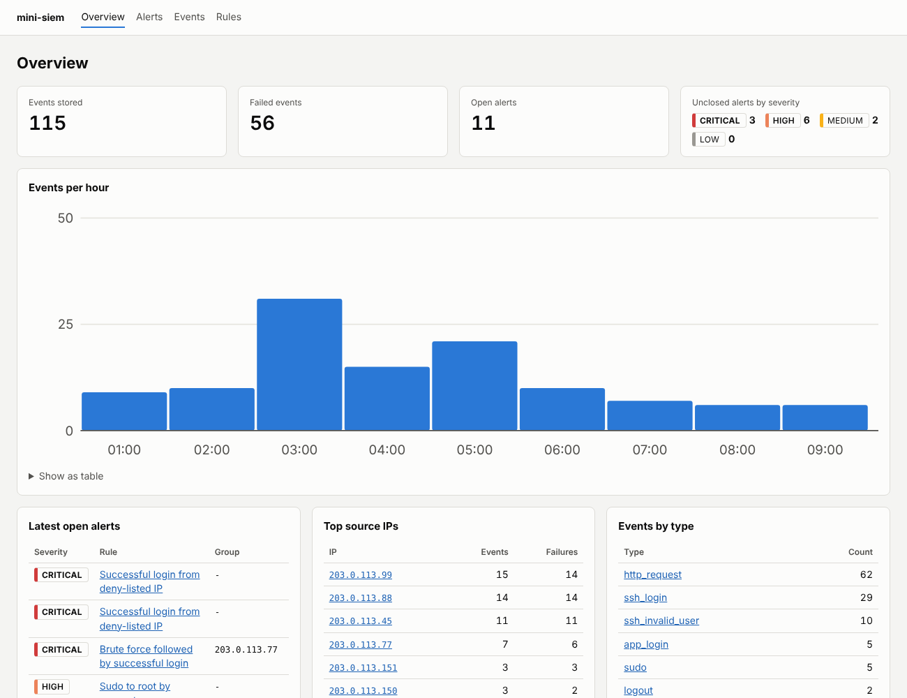
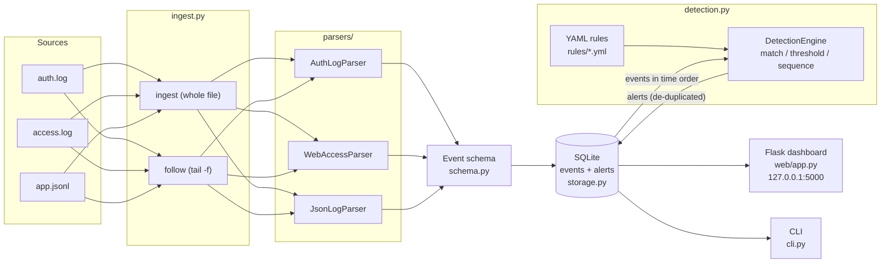

# mini-siem

A small, self-contained **SIEM (Security Information and Event Management)** system written in Python, built to learn how SIEMs work and to show it.

It reads Linux `auth.log`, Apache/Nginx access logs and JSON application logs, converts them into one common event format, stores them in SQLite, runs readable YAML correlation rules mapped to MITRE ATT&CK, and shows the results in a local web dashboard.

```
log files ─▶ parsers ─▶ normalised events ─▶ SQLite ─▶ detection rules ─▶ alerts ─▶ dashboard
```



---

## The problem

A single server already writes several logs in different formats: SSH logins in `auth.log`, web requests in `access.log`, application events as JSON. An attack usually shows up across several lines and sometimes across several files. One failed login means nothing, but 8 failed logins in 35 seconds followed by a success does. Reading raw logs by hand doesn't scale.

A SIEM fixes this by **collecting** logs, **normalising** them into one schema, **correlating** events against detection rules, and **raising alerts** that an analyst can triage. mini-siem does each of those steps in a small amount of readable code.

## Features

- **3 parsers** that normalise into one schema:
  - Linux `auth.log`: sshd failed/accepted password and publickey logins, invalid users, sudo success and failure. Classic syslog and RFC 3339 timestamps are both supported.
  - Apache/Nginx **combined** (and common) access logs. URLs are URL-decoded (twice, to catch double-encoding) before matching.
  - **JSON Lines** application logs, with alias mapping (`client_ip`/`src_ip`/`source.ip` → `source_ip`, and so on).
- **Ingestion**
  - `ingest FILE --type ...` loads a whole file. Running it again on the same file adds nothing, because every line gets a fingerprint.
  - `follow FILE --type ...` works like `tail -f`: it reads new lines as they are written and alerts live. It handles half-written lines and log rotation.
- **9 YAML detection rules** using 3 rule types (`match`, `threshold`, `sequence`), each mapped to MITRE ATT&CK.
- **Alerts** in SQLite with severity (`low`/`medium`/`high`/`critical`), workflow status (`open`/`acknowledged`/`closed`) and links to the evidence events. Repeated activity is folded into one alert instead of flooding the analyst.
- **Flask dashboard**: overview counts, an events-per-hour chart (server-rendered inline SVG, **no JavaScript, works offline**), an alerts table with filters and status changes, an alert detail page with its evidence, event search by IP, user, type or text, and a rules page.
- **Secure by default**: binds to `127.0.0.1`, all output is HTML-escaped, a strict Content-Security-Policy is set, status changes are CSRF-protected, all SQL is parameterised, and rules are loaded with `yaml.safe_load`.
- **115 pytest tests** covering parsers, every rule (positive and negative cases), storage, follow mode, the CLI and the Flask routes.
- Written for **Windows and Linux**: pure `pathlib`, binary-mode file reading and no shell calls. The test suite has been run on Linux with Python 3.10 and 3.13. Windows has not been tested yet; if something breaks there, please open an issue.

## Architecture



| Module | Responsibility |
|---|---|
| `src/mini_siem/schema.py` | The `Event` dataclass, which is the one normalised format |
| `src/mini_siem/parsers/` | One parser per log format: raw line → `Event` or `None` |
| `src/mini_siem/ingest.py` | Reads files (whole or followed) and stores events |
| `src/mini_siem/storage.py` | SQLite schema and all queries (parameterised) |
| `src/mini_siem/rules.py` | Loads and validates YAML rules and compiles filters |
| `src/mini_siem/detection.py` | The correlation engine (stateful detectors per rule) |
| `src/mini_siem/web/` | Flask app, Jinja templates, CSS, SVG chart geometry |
| `src/mini_siem/cli.py` | `mini-siem` command-line interface |

## Event schema

Every parser produces the same fields. The names are **loosely inspired by the [Elastic Common Schema (ECS)](https://www.elastic.co/guide/en/ecs/current/index.html)** (ECS has `source.ip`, `user.name`, `host.name`, `event.outcome`) but flattened for simplicity. This is not an ECS implementation.

| Field | Type | Example | Notes |
|---|---|---|---|
| `timestamp` | datetime (UTC) | `2026-10-14T03:15:00Z` | Always converted to UTC. Stored as fixed-width text, so string order = time order |
| `source` | str | `auth`, `web`, `json` | Which parser produced it |
| `event_type` | str | `ssh_login`, `ssh_invalid_user`, `sudo`, `http_request`, `app_login` | What happened |
| `outcome` | str | `success` / `failure` / `unknown` | Same three values as ECS `event.outcome` |
| `source_ip` | str or null | `203.0.113.45` | Validated with `ipaddress`; garbage becomes null |
| `user` | str or null | `root` | |
| `host` | str or null | `web01` | From the log, or `--host` |
| `raw` | str | the original line | Kept as evidence (capped at 8 KB) |
| `details` | JSON object | `{"status": 404, "url_decoded": "/.env"}` | Format-specific extras: HTTP method/URL/status/user agent, sudo command/target user, SSH method/port, unmapped JSON keys |

## Quickstart

You need Python 3.10 or newer. Run all commands from the project folder.

### Linux / macOS

```bash
cd mini-siem
python3 -m venv .venv
source .venv/bin/activate
pip install -r requirements.txt
pip install -e .
mini-siem demo            # loads samples/, prints alerts, starts http://127.0.0.1:5000
```

### Windows (PowerShell)

```powershell
cd mini-siem
py -m venv .venv
.\.venv\Scripts\Activate.ps1      # if blocked: Set-ExecutionPolicy -Scope CurrentUser RemoteSigned
pip install -r requirements.txt
pip install -e .
mini-siem demo
```

Open <http://127.0.0.1:5000> and press `Ctrl+C` in the terminal to stop. `python -m mini_siem ...` also works in place of `mini-siem ...`.

### Other commands

```bash
mini-siem ingest samples/auth.log   --type auth --year 2026     # syslog lines have no year
mini-siem ingest samples/access.log --type web  --host web01
mini-siem ingest samples/app.jsonl  --type json
mini-siem alerts --status open
mini-siem rules
mini-siem detect                     # re-run all rules over stored events
mini-siem follow /var/log/auth.log --type auth     # live mode, Ctrl+C to stop
mini-siem serve --port 5000          # dashboard on the default database
```

The database defaults to `./mini_siem.db` (override with `--db` or `MINI_SIEM_DB`). `demo` always uses a fresh `./mini_siem_demo.db`.

### Run the tests

```bash
pytest
```

## Sample output

This is real output from `mini-siem demo` on the bundled samples:

```
loaded auth.log     44 events (6 lines skipped)
loaded access.log   62 events (0 lines skipped)
loaded app.jsonl     9 events (1 lines skipped)
detection: 9 rules -> 11 alerts

 ID  SEVERITY  STATUS        FIRST SEEN (UTC)      RULE                      MESSAGE
 11  critical  open          2026-10-14T07:40:00Z  denylist_login            Successful app_login as 'grace' from deny-listed IP 192.0.2.10
 10  critical  open          2026-10-14T07:05:00Z  denylist_login            Successful ssh_login as 'bob' from deny-listed IP 192.0.2.66
  5  critical  open          2026-10-14T04:20:00Z  ssh_bruteforce_success    Successful SSH login as 'deploy' from 203.0.113.77 after 6 failed attempts
  9  high      open          2026-10-14T06:31:15Z  sudo_unusual_user         'dave' ran a command as root on web01: /bin/cat /etc/shadow
  7  high      open          2026-10-14T05:20:00Z  web_path_traversal        Possible path traversal from 203.0.113.151 (3 requests); latest: GET /static/../../../wind
  6  high      open          2026-10-14T05:00:00Z  password_spraying         203.0.113.88 failed logins for 7 different users (rule: 5+ users in 900s)
  4  high      open          2026-10-14T04:20:00Z  ssh_bruteforce            6 failed SSH logins from 203.0.113.77 (rule: 5+ in 60s); last user tried: deploy
  3  high      open          2026-10-14T04:10:00Z  web_sqli                  Possible SQL injection from 203.0.113.150 (3 requests); latest: GET /products.php?id=1; DR
  2  high      open          2026-10-14T03:15:00Z  ssh_bruteforce            8 failed SSH logins from 203.0.113.45 (rule: 5+ in 60s); last user tried: root
  8  medium    open          2026-10-14T06:30:00Z  web_xss                   Possible XSS from 203.0.113.152 (2 requests); latest: GET /search?q=">
  Many failed SSH password attempts from one IP in a short time.
severity: high                 # low | medium | high | critical
type: threshold                # match | threshold | sequence
filter:                        # ALL conditions must be true
  event_type: ssh_login        # plain value = equality
  outcome: failure
group_by: source_ip            # count separately per attacker IP
threshold: 5
window_seconds: 60
# suppress_seconds: 60         # default = window; follow-up events update the same alert
message: "{count} failed SSH logins from {group} (rule: {threshold}+ in {window_seconds}s)"
mitre:
  - id: T1110.001
    name: "Brute Force: Password Guessing"
    tactic: Credential Access
```

Filter operators:

| Syntax | Meaning |
|---|---|
| `field: value` | equals (case-insensitive, `404` matches the integer 404) |
| `field: {in: [a, b]}` / `{not_in: [a, b]}` | membership |
| `field: {regex: "..."}` | case-insensitive regex search |
| `field: {in_ip_list: deny_list.txt}` | IP is in a local file of IPs/CIDRs |

Fields are any schema field, or `details.<key>` (for example `details.status` or `details.url_decoded`).

- **threshold** rules also accept `distinct: <field>`, which counts *distinct values* instead of events (used for password spraying).
- **sequence** rules have `first: {filter, min_count}` and `then: {filter}` sections plus `group_by` and `window_seconds`.
- **match** rules alert per event. Add `group_by` + `suppress_seconds` to fold repeats from the same source into one alert.

Message templates can use `{count}`, `{group}`, `{threshold}`, `{window_seconds}`, `{source_ip}`, `{user}`, `{host}`, `{event_type}` and any scalar `details` key (`{url_decoded}`, `{status}`, `{command}`, …).

## How this relates to Splunk, QRadar and ELK

mini-siem implements the same pipeline as commercial SIEMs, only much smaller:

| Concept | mini-siem | Splunk | IBM QRadar | Elastic (ELK) |
|---|---|---|---|---|
| Collection | `ingest` / `follow` reading files | Universal Forwarder | WinCollect agent, syslog and other protocols | Beats / Elastic Agent, Logstash |
| Parsing / normalisation | `parsers/` → `Event` | Field extractions, CIM data models | DSMs map to QRadar's normalised fields | Ingest pipelines → ECS |
| Storage | SQLite | Indexes | Ariel database | Elasticsearch indices |
| Detection | YAML rules (match, threshold, sequence) | Correlation searches (SPL), Enterprise Security | Rules engine, building blocks → offenses | Detection rules (KQL, EQL sequences, threshold) |
| Alert workflow | open / acknowledged / closed | Notable events | Offenses | Alerts / cases |
| Rule language idea | Readable YAML | — | — | Close in spirit to **Sigma**, the vendor-neutral YAML rule format |

What the big products add: scale (billions of events, clustering), hundreds of parsers, threat-intel feeds, UEBA (behaviour baselines), SOAR (automated response), RBAC, retention and compliance reporting.

## Limitations

These are deliberate scope limits for a learning project:

- **Not production-grade.** The dashboard has **no authentication**. It binds to `127.0.0.1` and must not be exposed to a network. It uses Flask's development server.
- **Syslog timestamps have no year or timezone.** Classic `auth.log` lines are assumed to be **UTC** and the year comes from `--year` (default: the current year). Logs spanning New Year, or servers on local time, will be off. The RFC 3339 format avoids this.
- **Detection runs in time order per run.** `ingest` re-scans the whole database after each file (simple and correct, but O(all events)). `follow` keeps rule state in memory only for the events it sees, so it does not correlate with events stored before it started, and state is lost on restart.
- **Out-of-order events** (for example, two files ingested live in parallel) can be missed by window rules in `follow` mode. Batch `ingest`/`detect` sorts by time first.
- **Regex web rules are easy to evade** (comment injection, unusual encodings, payloads in POST bodies, which access logs don't record) and can false-positive on legitimate text. A WAF or application telemetry is a better source.
- **"Unusual" sudo is an allow-list**, not learned behaviour. The deny-list is a static local file.
- **De-duplication is by file name + byte offset + line content.** Two genuinely identical lines at the same position in two same-named files would be treated as one.
- **SQLite** is fine for hundreds of thousands of events, not for a real SOC's volume.
- The parsers cover the common message formats, not every sshd/sudo/PAM variant.

## Future work

- Windows Event Log parser (4624/4625 logon events, 4688 process creation) via exported EVTX/JSON
- Import [Sigma](https://github.com/SigmaHQ/sigma) rules (a subset) into the rule format
- Persist `follow`-mode detector state, or seed it from recent stored events on start-up
- Optional login for the dashboard; a proper WSGI server (waitress, which works on Windows)
- Alert notes and assignee, and export to CSV/JSON
- Syslog UDP/TCP listener as an input
- GeoIP enrichment from a local offline database
- Retention policy (delete events older than N days)

## Project layout

```
mini-siem/
├── src/mini_siem/          # the package (parsers, storage, rules, detection, web, cli)
├── rules/                  # YAML detection rules + deny_list.txt
├── samples/                # synthetic auth.log, access.log, app.jsonl
├── tests/                  # pytest suite
├── docs/INTERVIEW_GUIDE.md # plain-English walkthrough + interview prep
├── pyproject.toml
└── requirements.txt        # pinned versions
```

## License

MIT. See [LICENSE](LICENSE).
